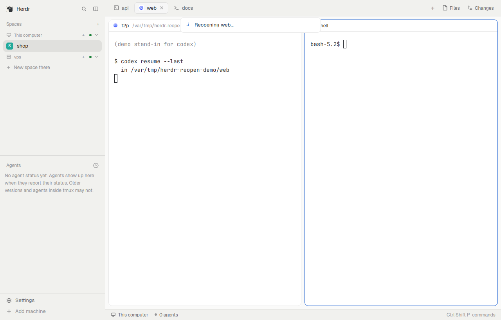

# herdr-reopen-tab

**Cmd+Shift+T for the [Herdr](https://herdr.dev) desktop app.** It brings back the tab you closed last:
- in its old place in its space, with its name;
- with its panes in their folders;
- with Claude Code and Codex picking up their last conversation there.

Press again for the close before that. A closed space comes back whole, and a tab on another machine comes back on that machine.



It is a Herdr app [mod](https://herdr.dev/mods), not a change to Herdr itself. Agents get the same action through MCP, a local JSON API and a CLI.

## Install

Ask your agent in Herdr: *"Add the mod at github.com/mustafaTokmak/herdr-reopen-tab"*. Herdr's own instructions tell it how.

Or by hand (Herdr must have been opened once):

```sh
git clone https://github.com/mustafaTokmak/herdr-reopen-tab
sh herdr-reopen-tab/install.sh
```

The installer:
- runs `herdr-app check` on the mod;
- copies it to `~/.config/herdr-app/mods/reopen-tab`;
- adds `"cmd-shift-t": "mod.open:reopen-tab"` to your `keys.json`, never replacing a key you already use;
- links the agent CLI as `~/.local/bin/herdr-reopen-tab` (if Node 18+ is installed).

Run it again to update.

On Linux and Windows the key is Super+Shift+T (`ctrl-shift-t` is already Herdr's new tab). If your desktop takes Super+Shift+T, bind `mod.open:reopen-tab` to a free key such as `alt-shift-t` in `keys.json`.

## What comes back

| Closed | Comes back |
|---|---|
| a tab, its space still open | into that space, before the first tab made after it |
| a whole space | the space, with its name and every tab closed with it, in order |
| `claude …` | `claude … --continue` (the first task isn't sent again) |
| `codex …` | `codex resume --last …` |
| a command that names a session, a one-shot run (`-p`), a subcommand | the same command |
| a shell or any other program | the same, in the folder it started in |
| a tab on another machine | on that machine |

**Limits:**
- Panes come back side by side with even widths, because herdr-core doesn't keep split shapes.
- A pane comes back in the folder it *started* in, not one it `cd`-ed to later.
- Mod panes don't come back.
- A tab nobody named comes back unnamed.
- [RECIPE.md](RECIPE.md) has the details, including a Herdr close race that can cost a slow-dying single-pane tab its name.

## For agents

Every human action here has an agent equivalent, with JSON output (and Markdown on request):

| Action | MCP tool | JSON API | CLI |
|---|---|---|---|
| Cmd+Shift+T | `herdr_closed_tab_reopen {tab?}` | `POST /v1/reopen` | `herdr-reopen-tab reopen [--tab ID]` |
| see what comes back | `herdr_closed_tabs_list` | `GET /v1/closed-tabs` | `herdr-reopen-tab list` |

```sh
claude mcp add herdr-reopen-tab -- node ~/.config/herdr-app/mods/reopen-tab/agent.mjs   # MCP (stdio)
node ~/.config/herdr-app/mods/reopen-tab/agent.mjs --http 0                             # loopback JSON API; prints its URL
herdr-reopen-tab list --md                                                              # CLI; JSON without --md
```

- Agent docs: [llms.txt](llms.txt), [llms-full.txt](llms-full.txt) (schemas) and the skill [SKILL.md](mods/reopen-tab/SKILL.md). All three are generated from [agent-tools.json](mods/reopen-tab/agent-tools.json) by `npm run docs`.
- A test fails the build when a key or `mod.open` has no MCP tool, JSON route or CLI command, or when the docs drift from the tool list.

Copy-paste prompt:

> List my recently closed Herdr tabs with herdr_closed_tabs_list and show me their names, spaces and when they closed. When I pick one, reopen it with herdr_closed_tab_reopen and its exact tab id (no id reopens the newest), then report the new tab id and what each pane runs. Do not close, restart or rename anything else.

## How it works

Nothing runs in the background. When you press the key, the mod reads herdr-core's records of finished terminals (`hc ls --all`, `hc get`). From those it rebuilds the newest closed tab with Herdr's own commands: `tab.new`, `pane.split`, `tab.move` and so on.

It runs:
- `hc` (read only);
- `sh -c 'test -d …'`, to check the folder still exists;
- `git rev-parse`, for the space name.

It writes only its own `data/reopen-tab/` folder, and it never reaches the network.

## Development

```sh
npm test                                       # 26 tests: plan logic, agent adapter, coverage, docs drift
npm run docs                                   # regenerate llms.txt, llms-full.txt, SKILL.md
herdr-app check mods/reopen-tab
```

`mods/reopen-tab/plan.js` is the logic, kept as pure functions. `main.js` is the popup that runs it inside Herdr, and `agent.mjs` is the agent side.

## License

MIT
